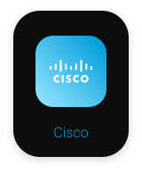
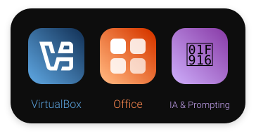

  

## 🧑‍💻 À propos de moi

### ❤️ J'adore particulièrement :

<table>
  <tr>
    <td align="center" width="200">🖥️ <b>Informatique</b></td>
    <td align="center" width="200">🚘 <b>Automobile</b></td>
    <td align="center" width="200">🚀 <b>Astronomie/Spatial</b></td>
    <td align="center" width="200">🧰 <b>Tout ce qui est technique</b> je peux rester devant un monument pendant 10 minutes pour comprendre comment il tient</td>
  </tr>
  <tr>
    <td align="center" width="200">🧈 <b>Design des objets</b> Surtout Apple</td>
    <td align="center" width="200">⚽ <b>Sport</b> je peux me passionner pour tous les sports</td>
    <td align="center" width="200">📖 <b>Lecture</b></td>
    <td align="center" width="200">☕ <b>Café...</b></td>
  </tr>
</table>

 

## 🛠️ Technologies

### 💻 Systèmes, Réseaux & Scripting

### 🌐 Développement Web (Fondations)

### 🔧 Outils & Environnement

 

## 🚀 Projets

 

## 📊 GitHub Stats

 

## 🎯 Objectifs

<table>
  <tr>
    <td align="center" width="250">🧭 Apprendre plein de domaines différents</td>
    <td align="center" width="250">💡 Faire plein de projets cools et différents</td>
    <td align="center" width="250">📈 Apprendre toujours +</td>
  </tr>
</table>

 

## 💼 Me retrouver

  

 

### ✨ Création

Aide d'Antigravity pour les animations.

